BookSim Interconnection Network Simulator
=========================================

[](https://github.com/shef/booksim2/actions/workflows/test.yml?query=branch%3Afabric)

BookSim is a cycle-accurate interconnection network simulator.
Originally developed for and introduced with the [Principles and Practices of Interconnection Networks](http://cva.stanford.edu/books/ppin/) book, its functionality has since been continuously extended.
The current major release, BookSim 2.0, supports a wide range of topologies such as mesh, torus and flattened butterfly networks, provides diverse routing algorithms and includes numerous options for customizing the network's router microarchitecture.

## What this fork adds

This fork extends BookSim to model accelerator scale-up fabrics (TPU ICI
tori and group networks, with Trainium NeuronLink and NVLink planned) so they
can be compared under the same traffic. Upstream behaviour is unchanged: the
upstream example configs reproduce their recorded statistics exactly.

- **`topology = fabric`**: a network read from files: routers that are chips
  (with any number of terminals) or switches (none), links with per-link
  latency and optional rate (slower links such as PCIe or NIC links beside
  the main fabric), per-chip injection caps, compute terminals (in-network
  reduce and replicate engines), and routing from offline tables or source
  routes, with multipath. Routing functions: `src`, `dor`, `esc`, `updown`,
  `duato`, `lduato` (Duato with a layered escape network, deadlock-free under
  link failures) and `ugal`.
- **`sim_type = messages`**: collectives as fixed messages with dependencies
  (whole-message or streamed), timed to completion, with stall (deadlock)
  detection. Generators for all-to-all, MoE, torus, Boardfly, ring, tree and
  in-network all-reduce, broadcast and pipelines ([doc/fabric/messages.md](doc/fabric/messages.md)).
- **`traffic = matrix`**: an endpoint-to-endpoint traffic matrix from a file,
  so collective phases (all-reduce stages, all-to-all) run as steady traffic.
  Also `groupshift(G)`, an adversarial pattern for group networks.
- **`measure_reorder = 1`**: per-pair packet reordering and the resequencing
  delay an in-order receiver would add.
- **Results and runs**: `stats_json` (one JSON per run: status, build commit,
  configuration, statistics), `link_util_file` (per-link load), and
  `utils/fabric/harness.py` (seeds with confidence intervals, load sweeps
  with saturation detection). Also: `batch_paced` (batch mode that honours
  the injection rate) and a fixed exit status (0 on success).
- **Tests**: `make -C src test` (upstream golden outputs plus fabric checks
  against analytical values), run by GitHub Actions on every push.

Exporters for TPU torus and Boardfly slices, a generic Clos, and collective
traffic: [utils/fabric](utils/fabric). A [collectives viewer](doc/viewer) shows
all-reduce and all-to-all moving through those fabrics in 3D, and how
virtual channels prevent deadlock.



Plans and progress: [doc/ROADMAP.md](doc/ROADMAP.md).

Documentation: [doc/README.md](doc/README.md): the simulator (file formats,
routing functions, options), one page per modelled system with its sources
and assumptions, and studies. Example: [src/examples/fabric](src/examples/fabric).

```
make -C src
cd src/examples/fabric && ../../booksim fabric_config
make -C src test
```

---

If you use BookSim in your research, we would appreciate the following citation in any publications to which it has contributed:

Nan Jiang, Daniel U. Becker, George Michelogiannakis, James Balfour, Brian Towles, John Kim and William J. Dally. A Detailed and Flexible Cycle-Accurate Network-on-Chip Simulator. In *Proceedings of the 2013 IEEE International Symposium on Performance Analysis of Systems and Software*, 2013.