# TPU 8i: Boardfly

TPU 8i (announced 2026) is Google's first inference-specific TPU and drops the
3D torus for Boardfly, a dragonfly-style network built for low all-to-all
latency: fully connected trays, fully connected groups of 8 trays over copper,
and groups joined through OCSes.

*Hierarchical all-reduce on a 4-group slice: tray, group, then global stage
(schematic timing). Interactive 3D version, with all-to-all:
[doc/viewer](../viewer/).*

## Sources

| Source | Date | What it gives |
|---|---|---|
| Google TPU 8 technical deep dive | 2026 | tray, group and pod structure; 1,152 chips, 1,024 active; 7-hop maximum; "up to 50% lower latency" |
| Jouppi and Lakshmanamurthy, Hot Chips 2026 | Aug 2026 | 6 ICI links x 8 lanes of 200G; tray drawn fully connected with a second copper link between paired trays |
| Public high-resolution 8i rack photo | 2026 | front-panel ports per tray: which carry copper and which fiber |
| Zu et al., NSDI 2024 | 2024 | failure rates of TPU v4 machines, ICI cables and OCSes |

## Physical fabric

- **Tray**: 4 chips, fully connected (3 links per chip): two board traces and
  one short copper loop cable (chips 0-3 and 1-2).
- **Group**: one rack of 8 trays (32 chips), fully connected over copper. Each
  chip has 2 copper links to other trays: 8 per tray, 7 for the full mesh of
  trays plus 1 extra link between paired trays.
- **Global**: each chip has 1 fiber to the OCS, so a group has 32 global
  ports.
- **Pod**: 36 groups (1,152 chips). Up to 32 groups (1,024 chips) are active;
  4 are spares.

The blog counts "16 external connections" per tray and "11 for intra-group
communication"; the rack photo shows that the 16 include the two in-tray loop
cables, which leaves 4 fibers per tray, 32 per group. That fits the
1,024-active-chip figure exactly: a 32-group slice needs 31 ports per group to
reach every other group directly, plus 1 spare.

## Link and latency parameters

| Parameter | Value | Confidence | Basis |
|---|---|---|---|
| Links per chip | 6 (3 tray, 2 copper, 1 fiber) | derived | Hot Chips block diagram and rack photo |
| Link rate per direction | 1.6 Tb/s | derived | 8 lanes of 200G SerDes (Hot Chips 2026) |
| In-tray hop | 60 ns | assumed | SerDes, FEC, board trace |
| Copper hop | 90 ns | assumed | SerDes, FEC, rack copper |
| Fiber hop (through the OCS) | 1,080 ns | assumed | as for the torus: 100 m from each TPU to the OCS |
| Receive buffer per ICI port | 1 MB, shared across VCs | assumed | full rate up to about 250 m from TPU to OCS; see the torus page for the derivation |

## Model

- One router per chip. Link kinds: 0 in-tray, 1 copper, 2 global.
- Global wiring: group port `r` of every group follows round-robin matching
  `r`, so every pair of groups in a 32-group slice has one direct link; a
  slice of N groups gets 32/(N-1) parallel links per pair.
- Routing: Duato's adaptive routing with a layered escape network (`lduato`):
  adaptive over every minimal port, escape on up*/down* with one VC layer per
  group hop. Fault-free: 2 adaptive and 2 escape VCs.
- Buffers: 4 VCs x 512 flits per port, enough for the fiber round trip.
- Exporter: [`utils/fabric/boardfly.py`](../../utils/fabric/boardfly.py)
  (slices, failures, OCS repair, tables; `--verify` checks the escape network
  is acyclic); all-reduce traffic from
  [`utils/fabric/collectives.py`](../../utils/fabric/collectives.py).

## Failure model

| Failure unit | What it removes | Handling |
|---|---|---|
| One optic or fiber | one global link | re-pair the two groups through spare ports (OCS), else route around |
| One copper cable | one in-group link | route around inside the group |
| One chip or tray (host) | 1 or 4 chips and their links | replace the group with a spare |
| One rack | a group | spare group |
| One OCS plane | half (2 planes) or a quarter (4 planes) of all global links | re-plan the surviving ports; route around |

## Assumptions

| Assumption | Value | Basis | Confidence | Effect on results |
|---|---|---|---|---|
| Tray, group, pod structure | as above | blog, Hot Chips, rack photo | derived | defines the model |
| Global port wiring | round-robin matchings | simplest wiring that gives one link per group pair | assumed | small for uniform traffic |
| OCS planes | 2 (ports 0-15 and 16-31), or 4 | 1,152 group ports; packaging not published | assumed | large: a plane outage keeps 16-30% of 32-group slice throughput with 2 planes, 59-83% with 4 (after re-planning) |
| Hop latencies | 60 / 90 / 1,080 ns (100 m to the OCS) | estimate | assumed | latency; the distance sweep gives the cost per metre |
| Receive buffer | 1 MB per port, shared across VCs | sized for about 250 m of reach | assumed | none within reach |
| VCs | 4 (5 tested) | not published | assumed | moderate under failures: the 5th VC is worth up to 24 points after a plane outage |
| Failure rates | NSDI 2024 v4 fleet rates | v4 is the closest published data | assumed | availability results |

## Validation

- The model's diameter is 7 hops, matching Google's "maximum latency of seven
  hops".
- Zero-load latency is 47% below an 8x8x16 torus at the same link
  latencies, matching Google's "up to 50% lower latency".
- With 1 MB shared buffers per port, all-reduce and all-to-all throughput are
  unchanged from 30 m to 300 m between TPU and OCS; only latency grows (about
  10 ns per metre, one fiber crossing per packet on average).

## Open questions

- How the OCS ports split into planes and boxes (the largest effect on
  failure results).
- The real global wiring and spare-port use.
- VC count and buffer depth.
